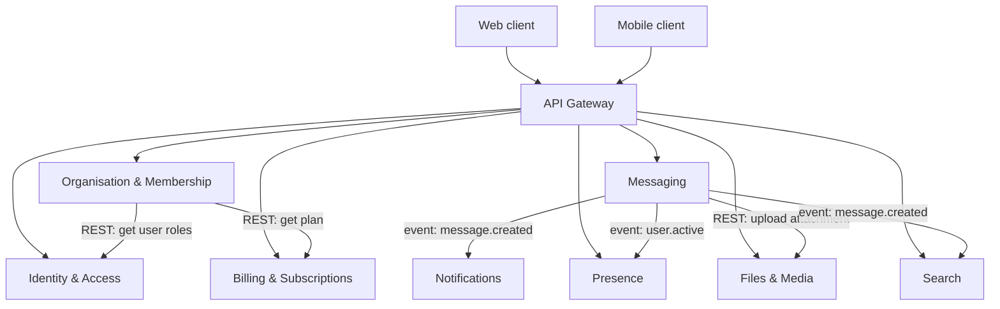

# Interactions

How the services communicate. Two patterns: synchronous REST for
request/response, and asynchronous events (over RabbitMQ) for fire-and-forget.

## Sync vs async

- **REST (sync)** when the caller needs a result before it can continue — e.g.
  Messaging asks Files to store an attachment, or Organisation checks a user's
  role in Identity.
- **Events (async)** when the work can happen later and must not slow down the
  core path — e.g. a new message fans out to Notifications and Search.

The point is to keep the core Messaging path fast: it publishes an event and
moves on, instead of waiting for every downstream service.
